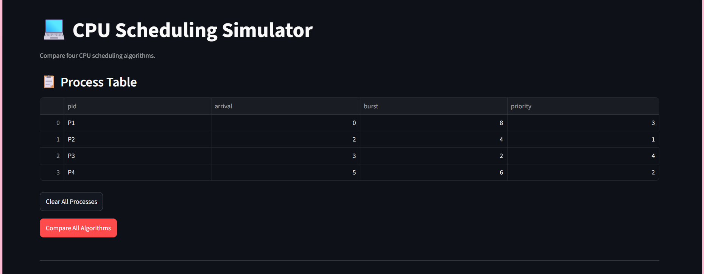
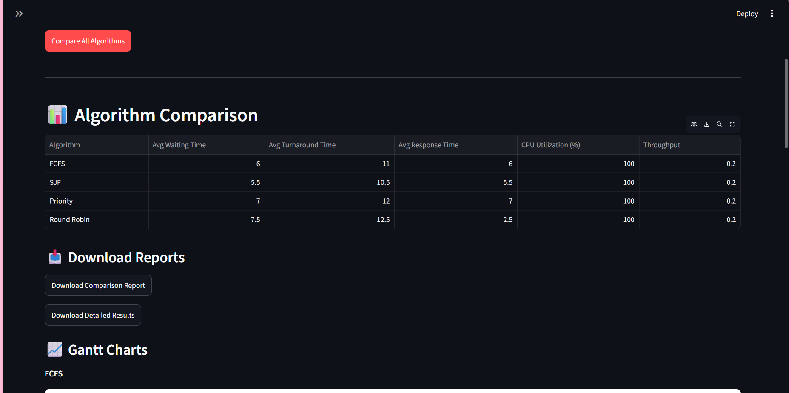
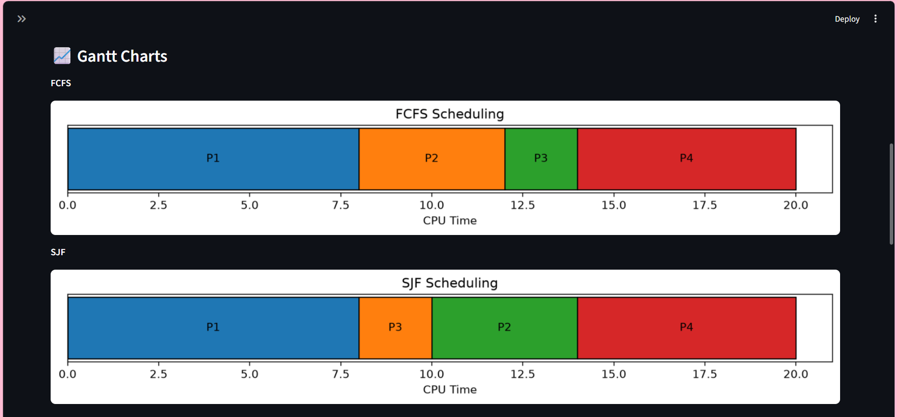
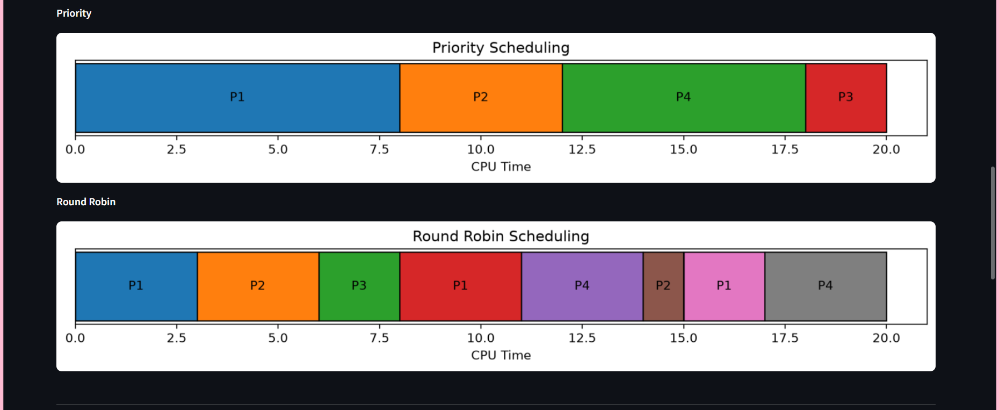
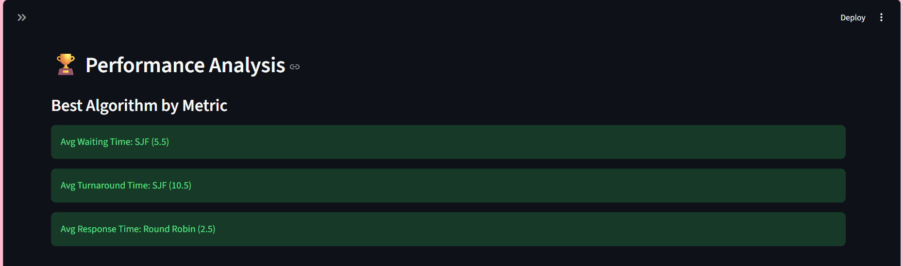
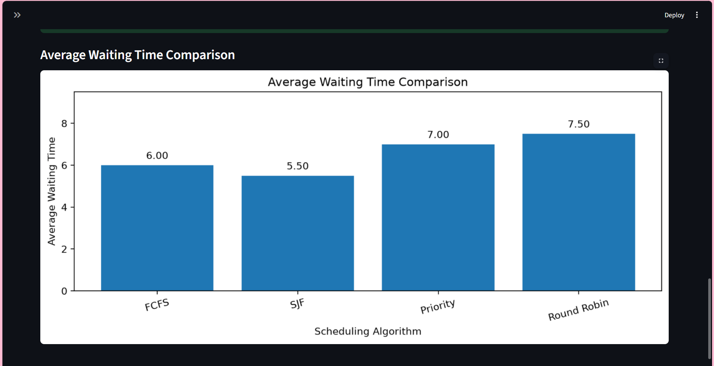

# CPU Scheduler Simulator

An interactive CPU Scheduling Simulator built using Python and Streamlit to visualize and compare different CPU scheduling algorithms.

## 🚀 Live Demo

**[Launch CPU Scheduler Simulator](https://namam-scheduling-visualizer.streamlit.app/)**

## ✨ Features

- Interactive process input
- CPU scheduling algorithm comparison
- Gantt chart visualization
- Waiting Time and Turnaround Time calculation
- Performance analysis

## 🧮 Algorithms Implemented

1. First Come First Serve (FCFS)
2. Shortest Job First (SJF – Non-Preemptive)
3. Priority Scheduling (Non-Preemptive)
4. Round Robin (RR)

## 📸 Screenshots

### Process Table


### Algorithm Comparison


### Gantt Charts




### Performance Analysis




## 🛠 Technologies Used

- Python
- Streamlit
- Pandas
- Matplotlib

## 💻 Installation

```bash
git clone https://github.com/namambhardwaj809-netizen/CPU_Scheduler_Simulator.git

cd CPU_Scheduler_Simulator

pip install -r requirements.txt

streamlit run app.py
```

## 👩‍💻 Author

**Namam Bhardwaj**

B.Tech – Computer Science and Engineering (Data Science and Machine Learning)
