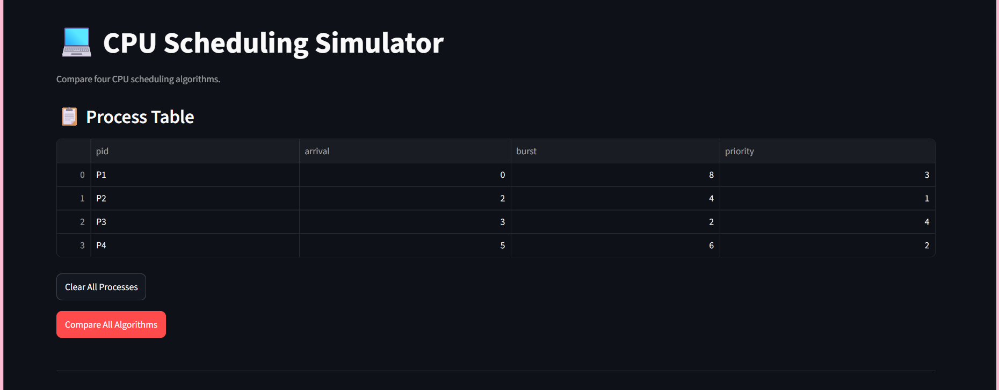
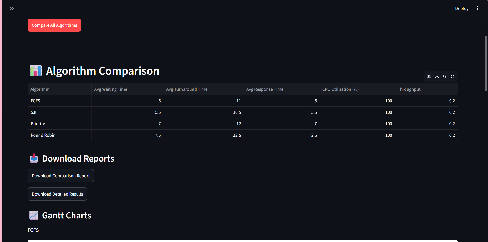
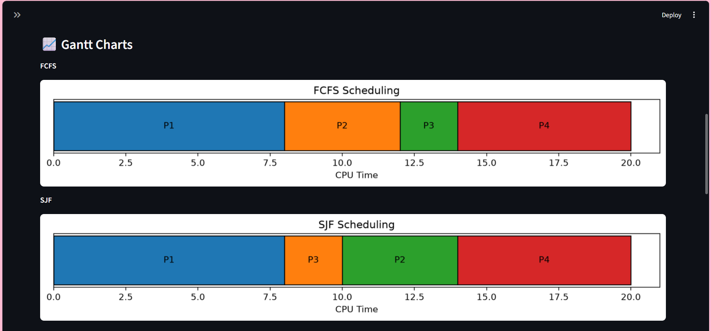
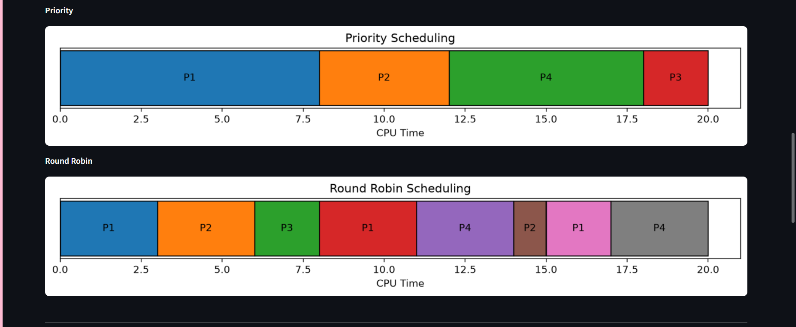
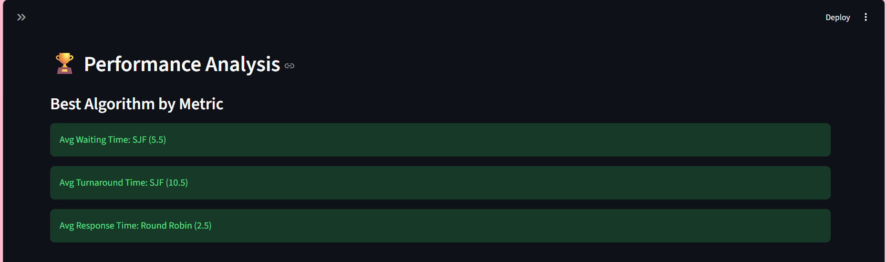
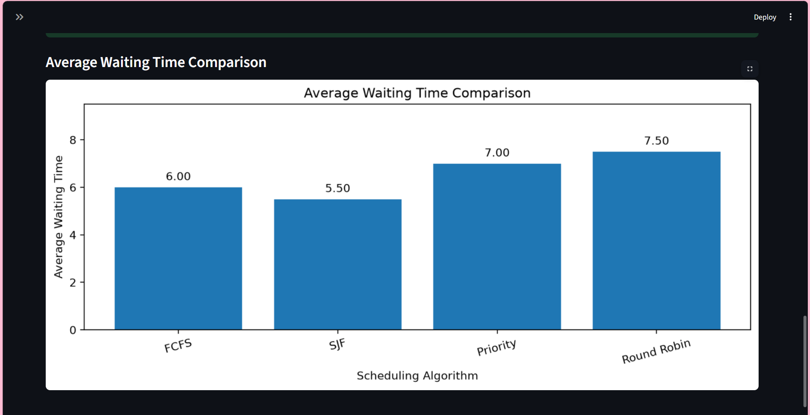


# INTELLIGENT CPU SCHEDULER SIMULATOR

## Project Report

**Project Title:** Intelligent CPU Scheduler Simulator

**Course:** CSE316

**Project Type:** Individual Project

**Interface:** Streamlit Web Dashboard

**Programming Language:** Python

**Algorithms Implemented:**
1. First Come First Serve (FCFS)
2. Shortest Job First (SJF) ΓÇô Non-preemptive
3. Priority Scheduling ΓÇô Non-preemptive
4. Round Robin (RR)

---

# 1. Introduction

CPU scheduling is an important function of an operating system. It determines which process gets access to the CPU and for how long.

Different scheduling algorithms use different approaches to select processes. These approaches affect waiting time, turnaround time, response time and CPU utilization.

The Intelligent CPU Scheduler Simulator is a Python-based web application developed using Streamlit. It allows users to enter process details, execute four CPU scheduling algorithms, compare their performance and visualize their execution through Gantt charts.


# 2. Problem Statement

In an operating system, multiple processes compete for CPU execution. Selecting an appropriate scheduling algorithm is important because it directly affects system performance.

Understanding and comparing scheduling algorithms manually can be difficult, especially when processes have different arrival times, burst times and priorities.

The objective of this project is to develop an interactive CPU Scheduling Simulator that implements four scheduling algorithms and provides a visual comparison of their performance.

# 3. Project Objectives

The main objectives of this project are:

1. Implement FCFS, non-preemptive SJF, non-preemptive Priority and Round Robin scheduling algorithms.
2. Allow users to enter process IDs, arrival times, burst times and priorities.
3. Allow users to configure the Round Robin time quantum.
4. Generate Gantt charts to visualize process execution.
5. Calculate average waiting time, average turnaround time and average response time.
6. Calculate CPU utilization and throughput.
7. Compare the performance of all four scheduling algorithms.
8. Provide downloadable CSV reports containing comparison and detailed process results.

# 4. Project Scope

The simulator focuses on CPU scheduling and performance comparison.

It provides:
- Interactive process configuration.
- Four CPU scheduling algorithms.
- Non-preemptive SJF and Priority scheduling.
- Configurable Round Robin time quantum.
- Gantt chart visualization, including CPU idle periods.
- Performance metrics and comparison.
- CSV report downloads.


# 5. Methodology

The project follows a structured development approach:

### Step 1: Input Collection

The user enters the following process information through the Streamlit sidebar:

- Process ID
- Arrival Time
- Burst Time
- Priority
- Time Quantum (for Round Robin)

### Step 2: Process Scheduling

The entered processes are passed to the four scheduling algorithms. Each algorithm determines the execution order based on its scheduling rules.

### Step 3: Performance Calculation

After scheduling, the simulator calculates:

- Waiting Time
- Turnaround Time
- Response Time
- CPU Utilization
- Throughput

### Step 4: Visualization

The application generates Gantt charts to represent process execution and CPU idle periods.

### Step 5: Performance Comparison

A comparison table and performance analysis section help users evaluate the results of all four algorithms.

### Step 6: Report Generation

Users can download two CSV files:
- CPU Scheduling Comparison Report
- CPU Scheduling Detailed Results

# 6. Technology Stack

| Technology | Purpose |
|---|---|
| Python | Core programming language |
| Streamlit | Interactive web dashboard |
| Pandas | Process data and result tables |
| Matplotlib | Gantt charts and performance graphs |
| VS Code | Development environment |
| Git | Version control |


# 7. Scheduling Algorithms

## 7.1 First Come First Serve (FCFS)

FCFS is a non-preemptive scheduling algorithm in which processes are executed in the order of their arrival time.

**Working Principle:**
1. Processes are arranged according to arrival time.
2. The CPU selects the process that arrived first.
3. Once execution begins, the process runs until completion.
4. The next available process is selected.

**Key Characteristic:** Simple and fair according to arrival order, but may cause long waiting times.

## 7.2 Shortest Job First (SJF) ΓÇô Non-preemptive

SJF selects the available process with the shortest burst time.

**Working Principle:**
1. Check which processes have arrived.
2. Select the available process with the smallest burst time.
3. Execute it until completion.
4. Repeat until all processes finish.

**Key Characteristic:** Can reduce average waiting time, but longer processes may experience starvation.

## 7.3 Priority Scheduling ΓÇô Non-preemptive

Priority Scheduling selects the available process with the highest priority.

In this project, a smaller priority number represents a higher priority.

**Working Principle:**
1. Check the available processes.
2. Select the process with the highest priority.
3. Execute it until completion.
4. Repeat until all processes finish.

**Key Characteristic:** Important processes can execute earlier, but low-priority processes may experience starvation.

## 7.4 Round Robin (RR)

Round Robin is a preemptive scheduling algorithm that gives each process a fixed CPU time called the time quantum.

**Working Principle:**
1. Processes enter a ready queue according to arrival time.
2. The CPU selects the first process in the queue.
3. The process executes for the time quantum or until completion.
4. If unfinished, it returns to the end of the ready queue.
5. The process continues receiving CPU time until completion.

**Key Characteristic:** Provides fair CPU sharing and is commonly associated with time-sharing systems.


# 8. Performance Metrics and Formulas

The simulator evaluates scheduling algorithms using five performance metrics.

## 8.1 Waiting Time

Waiting Time is the total time a process spends waiting in the ready queue.

**Formula:**

Waiting Time = Turnaround Time - Burst Time

## 8.2 Turnaround Time

Turnaround Time is the total time taken by a process from its arrival until its completion.

**Formula:**

Turnaround Time = Completion Time - Arrival Time

## 8.3 Response Time

Response Time is the time between process arrival and its first CPU execution.

**Formula:**

Response Time = First Start Time - Arrival Time

## 8.4 Average Waiting Time

It represents the average waiting time of all processes.

**Formula:**

Average Waiting Time = Sum of Waiting Times / Number of Processes

## 8.5 Average Turnaround Time

It represents the average turnaround time of all processes.

**Formula:**

Average Turnaround Time = Sum of Turnaround Times / Number of Processes

## 8.6 CPU Utilization

CPU Utilization represents the percentage of elapsed time during which the CPU is busy.

**Formula:**

CPU Utilization = (Total Burst Time / Total Elapsed Time) × 100

## 8.7 Throughput

Throughput represents the number of processes completed per unit of elapsed time.

**Formula:**

Throughput = Number of Completed Processes / Total Elapsed Time

# 9. Expected Output

The simulator produces:

1. A process input table.
2. A scheduling comparison table.
3. Four Gantt charts.
4. Performance analysis identifying the best algorithm for waiting time, turnaround time and response time.
5. Downloadable CSV reports.


# 10. System Architecture

The CPU Scheduling Simulator follows a modular architecture consisting of three main layers.

### 10.1 User Interface Layer

The Streamlit application provides:
- Process input fields.
- Process table.
- Algorithm comparison button.
- Performance comparison dashboard.
- Gantt chart visualizations.
- CSV download options.

### 10.2 Scheduling Logic Layer

The `algorithms.py` module contains the implementation of:
- FCFS
- Non-preemptive SJF
- Non-preemptive Priority
- Round Robin

Each algorithm processes the input data and calculates individual process metrics.

### 10.3 Data Processing and Visualization Layer

Pandas is used to organize process results and generate comparison tables.

Matplotlib generates Gantt charts and performance graphs.

### 10.4 Application Workflow

1. User enters process details.
2. Input data is stored in Streamlit session state.
3. User clicks Compare All Algorithms.
4. All four scheduling algorithms execute.
5. Performance metrics are calculated.
6. Results are displayed in tables and charts.
7. Users can download CSV reports.

# 11. Project File Structure

The project is organized as follows:

CPU_Scheduler_Simulator/
Γöé
Γö£ΓöÇΓöÇ venv/
Γöé
Γö£ΓöÇΓöÇ app.py
Γöé
Γö£ΓöÇΓöÇ algorithms.py
Γöé
Γö£ΓöÇΓöÇ requirements.txt
Γöé
ΓööΓöÇΓöÇ Project_Documentation/
    ΓööΓöÇΓöÇ Project_Report.md


# 12. Testing and Validation

The simulator is tested using different process configurations to verify the scheduling algorithms and performance calculations.

## 12.1 Functional Test Cases

| Test ID | Test Scenario | Expected Result |
|---|---|---|
| TC01 | Add a valid process | Process is added successfully |
| TC02 | Add duplicate Process ID | Error message is displayed |
| TC03 | Add an empty Process ID | Validation error is displayed |
| TC04 | Execute FCFS | Processes execute in arrival order |
| TC05 | Execute SJF | Shortest available process executes first |
| TC06 | Execute Priority | Highest-priority available process executes first |
| TC07 | Execute Round Robin | Processes execute using the configured time quantum |
| TC08 | Delayed process arrival | CPU idle periods are represented |
| TC09 | Compare algorithms | Performance comparison is displayed |
| TC10 | Download CSV reports | CSV files are generated successfully |

## 12.2 Validation

The project was tested with multiple process configurations, including:

- Processes with different arrival times.
- Processes with different burst times.
- Processes with different priorities.
- Different Round Robin time quantum values.
- Processes arriving after periods of CPU inactivity.

The test cases help verify the scheduling logic, visualizations and report generation features.

# 13. Limitations

The current version of the simulator has the following limitations:

1. SJF and Priority Scheduling are implemented in non-preemptive forms only.
2. Round Robin uses a user-configurable time quantum.
3. The simulator focuses on CPU scheduling and does not model memory management or I/O scheduling.
4. Results depend on the process information entered by the user.


# 14. Conclusion

The Intelligent CPU Scheduler Simulator provides an interactive platform for understanding and comparing different CPU scheduling algorithms.

The project successfully brings together FCFS, non-preemptive SJF, non-preemptive Priority Scheduling and Round Robin in a single Streamlit-based application.

Through Gantt charts, performance metrics, comparison tables and downloadable reports, users can observe how different scheduling strategies affect CPU performance.

This project also provides practical experience in Python programming, algorithm implementation, data processing and visualization.

# 15. Future Enhancements

The project can be extended with the following features:

1. Preemptive SJF (Shortest Remaining Time First).
2. Preemptive Priority Scheduling.
3. Improved Gantt chart customization.
4. Interactive process editing.
5. Additional performance metrics.
6. Exporting reports in PDF format.

# 16. References

1. Operating System Concepts ΓÇô Abraham Silberschatz, Peter B. Galvin and Greg Gagne.
2. Python Documentation: https://docs.python.org/3/
3. Streamlit Documentation: https://docs.streamlit.io/
4. Pandas Documentation: https://pandas.pydata.org/docs/
5. Matplotlib Documentation: https://matplotlib.org/stable/

## 17. Project Screenshots

### 17.1 Process Table


### 17.2 Algorithm Comparison


### 17.3 Gantt Charts



### 17.4 Performance Analysis



# 18. Module-Wise Breakdown

The project is divided into the following modules:

### 18.1 User Interface Module
The Streamlit interface allows users to enter process details, select scheduling algorithms, view results and download reports.

### 18.2 Scheduling Algorithms Module
The algorithms.py file implements four CPU scheduling algorithms:
- First Come First Serve (FCFS)
- Shortest Job First (SJF), non-preemptive
- Priority Scheduling, non-preemptive
- Round Robin (RR)

### 18.3 Performance Calculation Module
This module calculates completion time, waiting time, turnaround time and response time for each process.

### 18.4 Visualization Module
Matplotlib is used to generate Gantt charts and performance comparison graphs.

### 18.5 Report Generation Module
Pandas is used to organize scheduling results and generate downloadable CSV reports.

# 19. Project Functionalities

The simulator provides the following features:

1. **Process Input:** Users can add processes with process ID, arrival time, burst time and priority.
2. **Algorithm Selection:** Users can compare FCFS, SJF, Priority and Round Robin scheduling.
3. **Round Robin Configuration:** Users can set the time quantum.
4. **Gantt Charts:** Displays the execution order and duration of processes.
5. **Performance Metrics:** Calculates waiting time, turnaround time and response time.
6. **Algorithm Comparison:** Compares average performance metrics across all four algorithms.
7. **Performance Visualization:** Displays graphs for easier analysis.
8. **CSV Export:** Allows users to download scheduling results for further analysis.

# 20. System Flow Diagram

The overall workflow of the simulator is shown below:

```text
          START
            |
            v
     Enter Process Details
            |
            v
     Validate User Input
            |
            v
    Select Scheduling Algorithms
            |
            v
   Execute FCFS, SJF, Priority
        and Round Robin
            |
            v
   Calculate Performance Metrics
            |
            v
       Generate Gantt Charts
            |
            v
    Compare Algorithm Results
            |
            v
     Display Graphs and Results
            |
            v
       Download CSV Reports
            |
            v
           END

# 21. GitHub Revision Tracking

**GitHub Repository:** [CPU Scheduler Simulator](https://github.com/namambhardwaj809-netizen/CPU_Scheduler_Simulator)

Git and GitHub were used for version control and project development. Changes were committed with meaningful messages and pushed to the remote repository. A separate feature branch, `feature/algorithm-tests`, was created for implementing automated tests and was subsequently merged into the main branch.

The following table shows the seven project revisions:

| Revision | Commit ID | Description |
|---|---|---|
| 1 | `c9041db` | Initial commit - CPU Scheduler Simulator |
| 2 | `3e7a969` | Add project README with screenshots |
| 3 | `d9c1d17` | Add live demo and embed project screenshots |
| 4 | `2e3be2a` | Complete project report with diagrams and source code |
| 5 | `4869c4c` | Add automated tests for scheduling algorithms |
| 6 | `dff417a` | Document automated testing instructions |
| 7 | `e1b9b37` | Test idle CPU time before process arrival |

**Live Application:** [CPU Scheduler Simulator](https://namam-scheduling-visualizer.streamlit.app/)

# Appendix A — AI-Assisted Project Elaboration and Breakdown

## Project Title
Intelligent CPU Scheduler Simulator

## Project Overview
The project focuses on understanding and comparing CPU scheduling algorithms through an interactive web-based simulator.

## Main Components
1. User input and process management.
2. Implementation of four CPU scheduling algorithms.
3. Calculation of scheduling performance metrics.
4. Gantt chart generation.
5. Algorithm comparison and visualization.
6. CSV report generation.

## Development Approach
The project was developed using Python and Streamlit. Scheduling logic was implemented separately from the user interface to improve organization and maintainability.

## Learning Outcomes
- Understanding CPU scheduling concepts.
- Implementing scheduling algorithms in Python.
- Calculating process performance metrics.
- Visualizing algorithm execution.
- Using Git and GitHub for version control.
- Deploying an interactive application.

## Role of AI Assistance
AI tools were used for project planning, conceptual clarification, debugging guidance and documentation support. The implementation and testing were carried out as part of the individual project work.

# Appendix B — Project Problem Statement

## Intelligent CPU Scheduler Simulator

Design and develop an interactive CPU scheduling simulator that implements and compares the following algorithms:

1. First Come First Serve (FCFS)
2. Shortest Job First (SJF)
3. Round Robin (RR)
4. Priority Scheduling

The simulator should allow users to enter process information, including arrival time, burst time and priority.

It should provide visual representations of process execution using Gantt charts and calculate performance measures such as average waiting time and average turnaround time.

The objective is to help users understand how different CPU scheduling algorithms operate and compare their performance.

## Project Deliverable

A working, interactive application that demonstrates the scheduling algorithms and presents their results through tables, charts and performance comparisons.

**End of Project Report**


# Appendix C — Complete Project Source Code


## app.py

````python

import streamlit as st
import pandas as pd
import matplotlib.pyplot as plt

from algorithms import (
    fcfs,
    sjf,
    priority_scheduling,
    round_robin
)

st.set_page_config(
    page_title="CPU Scheduling Simulator",
    page_icon="💻",
    layout="wide"
)

st.title("💻 CPU Scheduling Simulator")
st.caption("Compare four CPU scheduling algorithms.")

# Initialize process storage
if "processes" not in st.session_state:
    st.session_state.processes = []

# Sidebar
st.sidebar.header("Process Configuration")

pid = st.sidebar.text_input("Process ID", value="P1")
arrival = st.sidebar.number_input(
    "Arrival Time", min_value=0, value=0
)
burst = st.sidebar.number_input(
    "Burst Time", min_value=1, value=1
)
priority = st.sidebar.number_input(
    "Priority", min_value=1, value=1
)

quantum = st.sidebar.number_input(
    "Time Quantum",
    min_value=1,
    value=2
)

if st.sidebar.button("Add Process"):
    pid = pid.strip()

    if not pid:
        st.sidebar.error("Enter a Process ID.")
    elif any(p["pid"] == pid for p in st.session_state.processes):
        st.sidebar.error("Process ID already exists!")
    else:
        st.session_state.processes.append({
            "pid": pid,
            "arrival": arrival,
            "burst": burst,
            "priority": priority
        })
        st.sidebar.success(f"{pid} added!")

# Main process table
st.subheader("📋 Process Table")

if st.session_state.processes:
    df = pd.DataFrame(st.session_state.processes)
    st.dataframe(df, use_container_width=True)

    if st.button("Clear All Processes"):
        st.session_state.processes = []
        st.rerun()
else:
    st.info("Add processes using the sidebar.")

# Run all algorithms
if st.button("Compare All Algorithms", type="primary"):

    if not st.session_state.processes:
        st.warning("Please add at least one process.")

    else:
        processes = st.session_state.processes

        results = {
            "FCFS": fcfs(processes),
            "SJF": sjf(processes),
            "Priority": priority_scheduling(processes)
        }

        rr_results, rr_gantt = round_robin(
            processes, quantum
        )

        results["Round Robin"] = rr_results

        st.session_state.results = results
        st.session_state.rr_gantt = rr_gantt

# Display comparison
if "results" in st.session_state:

    st.divider()
    st.header("📊 Algorithm Comparison")

    comparison = []

    for name, result in st.session_state.results.items():

        avg_waiting = sum(
            p["waiting"] for p in result
        ) / len(result)

        avg_turnaround = sum(
            p["turnaround"] for p in result
        ) / len(result)

        avg_response = sum(
            p["response"] for p in result
        ) / len(result)

        total_burst = sum(
            p["burst"] for p in result
        )

        first_arrival = min(
            p["arrival"] for p in result
        )

        last_completion = max(
            p["completion"] for p in result
        )

        elapsed = last_completion - first_arrival

        cpu_utilization = (
            total_burst / elapsed * 100
            if elapsed > 0 else 0
        )

        throughput = (
            len(result) / elapsed
            if elapsed > 0 else 0
        )

        comparison.append({
            "Algorithm": name,
            "Avg Waiting Time": round(avg_waiting, 2),
            "Avg Turnaround Time": round(avg_turnaround, 2),
            "Avg Response Time": round(avg_response, 2),
            "CPU Utilization (%)": round(cpu_utilization, 2),
            "Throughput": round(throughput, 3)
        })

    comparison_df = pd.DataFrame(comparison)

    st.dataframe(
        comparison_df,
        use_container_width=True,
        hide_index=True
    )

    st.subheader("📥 Download Reports")

    # Download comparison report
    comparison_csv = comparison_df.to_csv(
        index=False
    ).encode("utf-8")

    st.download_button(
        label="Download Comparison Report",
        data=comparison_csv,
        file_name="CPU_Scheduling_Comparison.csv",
        mime="text/csv"
    )

    # Download detailed process results
    detailed_results = []

    for algorithm, process_list in st.session_state.results.items():
        for process in process_list:
            detailed_results.append({
                "Algorithm": algorithm,
                **process
            })

    detailed_df = pd.DataFrame(detailed_results)

    detailed_csv = detailed_df.to_csv(
        index=False
    ).encode("utf-8")

    st.download_button(
        label="Download Detailed Results",
        data=detailed_csv,
        file_name="CPU_Scheduling_Detailed_Results.csv",
        mime="text/csv"
    )


    st.subheader("📈 Gantt Charts")

    gantt_data = {}

    for name, result in st.session_state.results.items():

        if name == "Round Robin":
            gantt_data[name] = st.session_state.rr_gantt
        else:
            gantt_data[name] = [
                {
                    "pid": p["pid"],
                    "start": p["start"],
                    "end": p["completion"]
                }
                for p in result
            ]


    for name, schedule in gantt_data.items():

        st.write(f"**{name}**")

        fig, ax = plt.subplots(figsize=(10, 1.8))

        current_time = 0

        for item in schedule:

            start = item["start"]
            end = item["end"]

            # Show CPU idle time
            if start > current_time:
                idle_time = start - current_time

                ax.barh(
                    0,
                    idle_time,
                    left=current_time,
                    height=0.5,
                    color="lightgray",
                    edgecolor="black"
                )

                ax.text(
                    current_time + idle_time / 2,
                    0,
                    "IDLE",
                    ha="center",
                    va="center"
                )

            # Show process execution
            ax.barh(
                0,
                end - start,
                left=start,
                height=0.5,
                edgecolor="black"
            )

            ax.text(
                (start + end) / 2,
                0,
                item["pid"],
                ha="center",
                va="center"
            )

            current_time = end

        ax.set_xlabel("CPU Time")
        ax.set_yticks([])
        ax.set_xlim(left=0)
        ax.set_title(f"{name} Scheduling")

        plt.tight_layout()
        st.pyplot(fig)
        plt.close(fig)


    st.divider()
    st.header("🏆 Performance Analysis")

    st.write("### Best Algorithm by Metric")

    metrics = [
        "Avg Waiting Time",
        "Avg Turnaround Time",
        "Avg Response Time"
    ]

    for metric in metrics:
        best_index = comparison_df[metric].idxmin()
        best_algorithm = comparison_df.loc[
            best_index, "Algorithm"
        ]
        best_value = comparison_df.loc[
            best_index, metric
        ]

        st.success(
            f"{metric}: {best_algorithm} "
            f"({best_value})"
        )


    st.write("### Average Waiting Time Comparison")

    fig, ax = plt.subplots(figsize=(9, 4))

    algorithms = comparison_df["Algorithm"].tolist()
    waiting_times = comparison_df["Avg Waiting Time"].tolist()

    bars = ax.bar(
        algorithms,
        waiting_times
    )

    ax.set_ylabel("Average Waiting Time")
    ax.set_xlabel("Scheduling Algorithm")
    ax.set_title("Average Waiting Time Comparison")

    ax.bar_label(bars, fmt="%.2f", padding=4)

    ax.set_ylim(
        0,
        max(waiting_times) * 1.2 + 0.5
    )

    plt.xticks(rotation=15)
    plt.tight_layout()

    st.pyplot(fig)
    plt.close(fig)

````

## algorithms.py

````python

def fcfs(processes):
    processes = sorted(processes, key=lambda p: p["arrival"])

    current_time = 0
    results = []

    for process in processes:
        pid = process["pid"]
        arrival = process["arrival"]
        burst = process["burst"]

        start_time = max(current_time, arrival)
        completion_time = start_time + burst

        turnaround_time = completion_time - arrival
        waiting_time = turnaround_time - burst
        response_time = start_time - arrival

        results.append({
            "pid": pid,
            "arrival": arrival,
            "burst": burst,
            "start": start_time,
            "completion": completion_time,
            "waiting": waiting_time,
            "turnaround": turnaround_time,
            "response": response_time
        })

        current_time = completion_time

    return results

def sjf(processes):
    processes = sorted(processes, key=lambda p: p["arrival"])

    current_time = 0
    remaining = processes.copy()
    results = []

    while remaining:
        available = [
            p for p in remaining
            if p["arrival"] <= current_time
        ]

        if not available:
            current_time = remaining[0]["arrival"]
            continue

        process = min(available, key=lambda p: p["burst"])

        pid = process["pid"]
        arrival = process["arrival"]
        burst = process["burst"]

        start_time = current_time
        completion_time = start_time + burst

        turnaround_time = completion_time - arrival
        waiting_time = turnaround_time - burst
        response_time = start_time - arrival

        results.append({
            "pid": pid,
            "arrival": arrival,
            "burst": burst,
            "start": start_time,
            "completion": completion_time,
            "waiting": waiting_time,
            "turnaround": turnaround_time,
            "response": response_time
        })

        current_time = completion_time
        remaining.remove(process)

    return results

def priority_scheduling(processes):
    processes = sorted(processes, key=lambda p: p["arrival"])

    current_time = 0
    remaining = processes.copy()
    results = []

    while remaining:
        available = [
            p for p in remaining
            if p["arrival"] <= current_time
        ]

        if not available:
            current_time = remaining[0]["arrival"]
            continue

        process = min(
            available,
            key=lambda p: (p["priority"], p["arrival"])
        )

        pid = process["pid"]
        arrival = process["arrival"]
        burst = process["burst"]

        start_time = current_time
        completion_time = start_time + burst

        turnaround_time = completion_time - arrival
        waiting_time = turnaround_time - burst
        response_time = start_time - arrival

        results.append({
            "pid": pid,
            "arrival": arrival,
            "burst": burst,
            "priority": process["priority"],
            "start": start_time,
            "completion": completion_time,
            "waiting": waiting_time,
            "turnaround": turnaround_time,
            "response": response_time
        })

        current_time = completion_time
        remaining.remove(process)

    return results


from collections import deque


def round_robin(processes, quantum):
    processes = sorted(processes, key=lambda p: p["arrival"])

    remaining = {
        p["pid"]: p["burst"] for p in processes
    }

    first_start = {}
    completion = {}
    gantt = []

    ready_queue = deque()
    current_time = 0
    index = 0

    while index < len(processes) or ready_queue:

        if not ready_queue and index < len(processes):
            current_time = max(
                current_time, processes[index]["arrival"]
            )

        while (index < len(processes)
               and processes[index]["arrival"] <= current_time):
            ready_queue.append(processes[index])
            index += 1

        if not ready_queue:
            continue

        process = ready_queue.popleft()
        pid = process["pid"]

        if pid not in first_start:
            first_start[pid] = current_time

        start = current_time
        execution = min(quantum, remaining[pid])

        current_time += execution
        remaining[pid] -= execution

        gantt.append({
            "pid": pid,
            "start": start,
            "end": current_time
        })

        while (index < len(processes)
               and processes[index]["arrival"] <= current_time):
            ready_queue.append(processes[index])
            index += 1

        if remaining[pid] > 0:
            ready_queue.append(process)
        else:
            completion[pid] = current_time

    results = []

    for p in processes:
        pid = p["pid"]
        turnaround = completion[pid] - p["arrival"]

        results.append({
            "pid": pid,
            "arrival": p["arrival"],
            "burst": p["burst"],
            "start": first_start[pid],
            "completion": completion[pid],
            "waiting": turnaround - p["burst"],
            "turnaround": turnaround,
            "response": first_start[pid] - p["arrival"]
        })

    return results, gantt


if __name__ == "__main__":
    processes = [
        {"pid": "P1", "arrival": 0, "burst": 5},
        {"pid": "P2", "arrival": 1, "burst": 3},
        {"pid": "P3", "arrival": 2, "burst": 2},
    ]

    result, gantt = round_robin(processes, quantum=2)

    print("Round Robin Results:")

    for process in result:
        print(process)

    print("\nGantt Chart:")
    for item in gantt:
        print(item)


````

## requirements.txt

````text
streamlit
pandas
matplotlib

````

